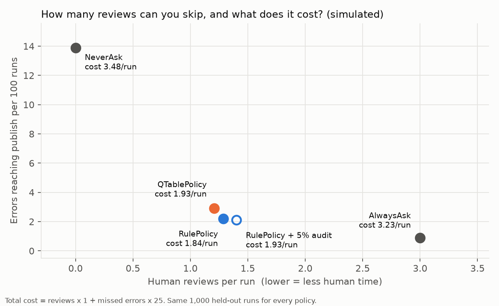
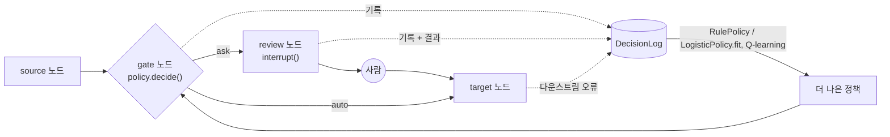

# hitl-gate

**사람이 늘 승인하는 일로 사람을 멈춰 세우지 마세요.** LangGraph human-in-the-loop 단계를 위한, 학습 가능한 "사람에게 물어볼까?" 게이트.

 

[English README](README.md)



함께 제공되는 시뮬레이션 문서 파이프라인([`examples/document_pipeline`](examples/document_pipeline/run.py), 홀드아웃 1,000회 실행. 모든 수치는 시뮬레이션 결과):

- **AlwaysAsk**는 실행당 3.00건을 사람에게 보내고, 100회 실행당 0.9건의 오류를 통과시킵니다.
- 로그 500회로 학습한 **RulePolicy**는 실행당 1.29회만 묻고(**검토 57% 감소**) 100회당 2.2건의 오류를 통과시키며, 총비용은 실행당 3.23에서 1.84로 줄어듭니다.
- 같은 로그로 학습한 **LogisticPolicy**(건별 오류 확률이 `검토 비용 / 놓침 비용` = 4%를 넘으면 묻기)는 실행당 0.83회만 묻고(**검토 72% 감소**) 100회당 3.0건을 통과시키며, 총비용이 가장 낮습니다: 실행당 1.84 → **1.58**.
- **NeverAsk**는 100회당 13.9건의 오류를 통과시킵니다. 검토를 아예 없애는 건 답이 아닙니다.

## 왜 필요한가

대부분의 에이전트 그래프는 검토 지점마다 `interrupt()`를 넣습니다. 첫날에는 안전하지만 곧 이렇게 됩니다.

- **검토 피로.** 문제없는 항목 수백 건을 본 사람은 보지 않고 승인하기 시작합니다(도장 찍기, rubber-stamping). 검토 단계는 비용은 그대로인데 오류를 더 이상 잡지 못합니다.
- **검토 단계를 없애는 건 위험합니다.** 어떤 항목은 정말로 사람이 봐야 하고, 그게 어떤 항목인지는 직감으로 알 수 없습니다.
- **항목별로, 근거를 가지고 판단하세요.** 대부분의 항목은 사람이 수백 번 수정 없이 승인한 상황에 속합니다. 나머지는 그렇지 않습니다. `hitl-gate`는 모든 검토 결정과 그 결과를 기록하고, 그 로그로 항목마다 물어볼 가치가 있는지 판단합니다.

## 30초 퀵스타트

```bash
pip install git+https://github.com/doertail/hitl-gate   # 아직 PyPI에 없음. 또는 clone 후 `pip install -e .`
```

```python
from typing import Annotated, TypedDict
from langgraph.checkpoint.memory import MemorySaver
from langgraph.graph import END, START, StateGraph
from hitl_gate import AlwaysAsk, DecisionLog, RulePolicy, add_gated_review, merge_dicts

class State(TypedDict, total=False):
    run_id: str
    hitl_decisions: Annotated[dict, merge_dicts]  # 게이트 결정이 저장되는 곳
    draft: str
    confidence: str

builder = StateGraph(State)
builder.add_node("draft", lambda s: {"draft": "Dear customer, ...", "confidence": "high"})
builder.add_node("send", lambda s: {})
builder.add_edge(START, "draft")

log = DecisionLog("decisions.jsonl")
gate = add_gated_review(
    builder, "review_draft", source="draft", target="send",
    policy=AlwaysAsk(),                                   # 안전하게 시작
    featurize=lambda s: {"confidence": s["confidence"]},  # 이산적이고 관측 가능한 신호
    make_review_payload=lambda s: {"draft": s["draft"]},  # 사람이 보게 될 내용
    apply_answer=lambda s, a: a.get("changes", {}),       # 사람의 수정 -> state 업데이트
    log=log,
)
builder.add_edge("send", END)
graph = builder.compile(checkpointer=MemorySaver())       # interrupt에는 checkpointer가 필요

# 나중에 로그에 근거가 쌓이면:
gate.policy = RulePolicy.fit(log.records, keys=["confidence"])
```

interrupt 재개는 평소 LangGraph 방식대로 하되, 게이트가 기대하는 답 형식을 씁니다.

```python
from langgraph.types import Command

graph.invoke(Command(resume={"outcome": "approve", "review_seconds": 12.0}), config)
# outcome: "approve" | "edit" | "retry" | "escalate";  선택적으로 "changes": {...}
```

`hitl_gate.sim.run_episode(graph, inputs, reviewer, thread_id)`가 invoke / interrupt / resume 루프를 스크립트 검토자로 대신 돌려 줍니다. 테스트와 시뮬레이션에 편리합니다.

## 도구 호출 승인

에이전트에서 실제로 가장 흔한 HITL은 **도구 호출** 승인입니다("send_email", "issue_refund"). 위험한 도구를 `gated_tool`로 감싸면 호출마다 정책이 ask(approve / edit / reject / respond를 받는 interrupt) 또는 auto(도구를 그냥 실행)를 정합니다. 감싸지 않은 도구는 게이트되지 않습니다.

```python
from langgraph.prebuilt import ToolNode
from hitl_gate import AlwaysAsk, DecisionLog, RulePolicy, gated_tool

log = DecisionLog("tool_decisions.jsonl")
refund = gated_tool(
    issue_refund, policy=AlwaysAsk(), log=log,               # gate_id 기본값은 도구 이름
    featurize=lambda name, args: {"big": args["amount"] > 50},
)
tools = ToolNode([lookup_order, refund])                     # 또는 create_agent(model, tools=[lookup_order, refund], checkpointer=...)

# interrupt 값(LangChain HITLRequest 형식): {"action_requests": [{"name", "args", "description"}], "review_configs": [...], "hitl_gate": {...}}
graph.invoke(Command(resume={"decisions": [{"type": "approve"}]}), config)
#   {"type": "edit", "edited_action": {"name": "issue_refund", "args": {"amount": 20}}} | {"type": "reject", "message": "..."} | {"type": "respond", "message": "..."}

refund.gate.policy = RulePolicy.fit(log.records, keys=["big"])  # 소액 환불은 auto, 고액은 계속 ask
log.mark_downstream(tool_message.tool_call_id, "issue_refund", True)  # 나중에 문제가 된 환불
```

LangChain `create_agent`를 쓴다면 공식 미들웨어를 게이트 버전으로 바꿔 끼울 수도 있습니다. 공식 요청/응답 형식과 배치 방식을 그대로 유지하므로 기존 승인 UI(Agent Inbox 류)가 그대로 동작합니다.

```python
from hitl_gate.middleware import GatedHumanInTheLoopMiddleware   # pip install "hitl-gate[langchain]"

agent = create_agent(model, tools, checkpointer=MemorySaver(), middleware=[
    GatedHumanInTheLoopMiddleware({"issue_refund": True, "send_email": True}, policy=policy, log=log, featurize=featurize),
])
```

| 통합 방식 | 필요 패키지 | 테스트 버전 |
|---|---|---|
| `ToolNode`, 직접 만든 ReAct 그래프, `create_agent(tools=...)`에서 `gated_tool(...)` | 코어만(`langgraph`, `langchain-core`가 함께 설치됨) | langgraph 1.2.14, langgraph-prebuilt 1.1.0, langchain-core 1.6.9 |
| `create_agent`용 `GatedHumanInTheLoopMiddleware` | `hitl-gate[langchain]` (`langchain>=1.4`, `InterruptOnConfig.when`이 추가된 버전) | langchain 1.4.4 |

동기와 비동기(`ainvoke`) 모두 테스트되어 있습니다. 로그의 `run_id`는 **tool call id**(`ToolMessage.tool_call_id`와 같음), `gate_id`는 도구 이름이므로 `mark_downstream(tool_call_id, tool_name, error)`로 호출 하나에 라벨을 붙입니다. 도구 호출용으로 `human_outcome`에 `"reject"`, `"respond"`가 추가됩니다. 각 decision에 `"review_seconds"`를 넣을 수 있습니다.

**재개 시 결정의 일관성.** 여기에는 별도 게이트 노드가 없어서, 재개하면 LangGraph가 도구(또는 미들웨어의 `after_model`)를 처음부터 다시 실행합니다. 결정은 로그에 기록될 때까지 `(thread_id, gate_id, tool_call_id)` 단위로 메모리에 캐시되고, 감사 샘플링은 스트림의 다음 난수가 아니라 `(seed, gate_id, thread_id:tool_call_id)`의 안정적인 해시입니다(`GateDecider(..., key=...)`). 따라서 재개된 호출은 같은 결정에 도달하고 레코드를 정확히 하나만 남깁니다. `seed`를 주고 정책이 결정적이면 프로세스 재시작 뒤에도 마찬가지입니다. 테스트가 이를 검증합니다.

[`examples/tool_approval`](examples/tool_approval/run.py)은 고객지원 에이전트를 오프라인으로 돌립니다(스크립트 모델, 시뮬레이션 검토자, 약 3초). 항상 묻는 대화 200건 뒤 학습한 `RulePolicy`는 50 이하 환불을 자동 승인하고(다음 200건 중 137건 중 131건, 6건은 감사), 그보다 큰 환불과 모든 이메일은 계속 사람에게 보냅니다.

## 동작 방식



`add_gated_review`는 `source`와 `target` 사이에 노드 두 개를 넣습니다.

- **`{gate_id}__gate`**: state에서 피처를 뽑고, 정책에 묻고, shadow 모드와 audit 샘플링을 적용한 뒤 결정을 `state["hitl_decisions"][gate_id]`에 저장합니다. 조건부 엣지로 라우팅합니다.
- **`{gate_id}__review`**: `interrupt({"gate_id", "reason", "payload"})`를 호출하고, 사람의 답을 적용한 뒤 결과를 기록합니다.

결정을 별도 노드에 두는 데는 이유가 있습니다. **LangGraph는 `interrupt()` 이후 재개할 때 interrupt를 호출한 노드를 처음부터 다시 실행합니다.** ask/auto 동전 던지기(audit 샘플링, 탐색)가 그 노드 안에 있으면 재개할 때 다시 굴려집니다. 여기서는 결정이 interrupt 전에 체크포인트되고, review 노드는 그 결정을 읽기만 합니다. 테스트 스위트가 이를 검증합니다.

그래프를 직접 연결한다면 `GateDecider(policy, mode, audit_rate, seed)`를 바로 쓰세요. state에 저장할 수 있는 평범한 dict를 반환하고, `make_record(run_id, gate_id, decision, answer)`가 로그 항목을 만듭니다.

**시드.** audit 샘플링은 게이트마다 따로 둔 난수 생성기를 쓰며, 시드는 `f"{seed}:{gate_id}"`에서 만듭니다(SHA-512 해시라 파이썬의 솔트된 `hash()`와 달리 프로세스가 바뀌어도 같음). 모든 게이트에 같은 `seed`를 줘도 됩니다. 게이트마다 독립적이고 재현 가능한 난수열을 받고, `GateDecider` 하나가 여러 게이트를 맡아도 게이트별 decider를 따로 둔 것과 같게 동작합니다.

## 정책

| 정책 | 물어보는 경우 | 학습 원천 |
|---|---|---|
| `AlwaysAsk` | 항상 (현재의 기본값) | — |
| `NeverAsk` | 절대 안 물음 (베이스라인 전용) | — |
| `RulePolicy.fit(records, keys, min_count=30, max_change_rate=0.02)` | 버킷 `(gate_id, 피처 값)`의 검토 샘플이 `min_count` 미만이거나 **또는** miss 비율이 `max_change_rate`를 넘을 때. 모르는 버킷 → ask. `describe()`가 규칙을 출력. | 기록된 검토 |
| `LogisticPolicy.fit(records, threshold, min_gate_samples=0)` | `p(miss) > threshold`일 때. `p`는 항목의 모든 피처(숫자는 표준화, 나머지는 원-핫)와 게이트별 절편으로 만든 로지스틱 회귀이고, `threshold = 검토 비용 / 놓침 비용`(float 또는 게이트별 dict)으로 둡니다. 모델 하나를 **여러 게이트가 함께 학습**할 수 있어, 건수가 적은 게이트도 다른 게이트가 배운 것을 빌려 씁니다. 처음 보는 게이트나 `min_gate_samples` 미만 → ask. `proba()`, JSON `save()`/`load()`. 순수 파이썬, 추가 의존성 없음. | 기록된 검토 (`RulePolicy`와 같은 놓침 라벨) |
| `QTablePolicy` | `(gate_id, 이산화된 피처)`에서 `Q(ask) >= Q(auto)`일 때. 동점과 처음 보는 상태 → ask. 학습용 epsilon-greedy `act()`, `learn_episode()`, JSON `save()`/`load()`. | 직접 정의한 보상 (예: `-review_cost`, `-error_cost`) |

`RulePolicy` 버킷은 `keys` 중 그 게이트의 피처에 실제로 있는 키만 씁니다. 그래서 피처가 서로 다른 게이트들이 `keys` 목록 하나를 같이 써도 되고, `describe()`는 게이트마다 자기 조건만 보여 줍니다.

**`QTablePolicy` 학습률.** `update()`와 `learn_episode()`의 `alpha`는 실수(고정 학습률), `"visit"`(`(상태, 행동)`별 `1/n`, 즉 Q가 목표값의 누적 평균), 또는 호출 가능 객체 `alpha(n)`을 받습니다. 드물지만 큰 비용(놓친 오류가 검토보다 훨씬 비쌈)이 있으면 고정 학습률에서는 그런 비용이 들어올 때마다 Q가 크게 출렁이는데, `"visit"`는 이를 평균으로 흡수합니다. 나중에도 계속 적응하도록 하한을 둔 `1/n`이 필요하면 `alpha=lambda n: max(1 / n, 0.001)`을 넘기세요. 방문 횟수는 `policy.n`에 있고 `save()`가 함께 저장합니다. 0.1.0에서 저장한 파일은 빈 방문 횟수로 불러옵니다.

`name: str`과 `decide(gate_id, features) -> (ask: bool, reason: str)`를 가진 객체는 무엇이든 정책이 될 수 있습니다.

### 도장 찍기(rubber-stamp) 방지

"approve"라는 검토 결과가 항목이 괜찮았다는 증거는 아닙니다. `RulePolicy`는 사람이 결과를 바꿨거나, **또는** 승인했지만 나중에 다운스트림에서 실패한 경우(`DecisionLog.mark_downstream(run_id, gate_id, error=True)`)를 **miss**로 셉니다. 검토자가 전부 통과시키는데 나중에 계속 오류가 나는 버킷은 안전하다고 학습되지 않고 "ask"로 남습니다.

## 안전한 롤아웃

1. **Shadow.** `add_gated_review(..., mode="shadow")`: 사람에게는 항상 묻고, 정책이 *어떻게 했을지*를 로그에 남깁니다(`mode="shadow"`). 믿기 전에 정책이 auto로 보냈을 항목을 실제 결과와 비교하세요.
2. **audit를 곁들인 제한적 auto.** `audit_rate=0.05`로 라이브 전환: auto 결정의 5%는 여전히 사람에게 보내지고 `mode="audit"`로 기록됩니다. auto가 통과시키는 항목의 편향 없는 샘플을 얻을 수 있습니다.
3. **다운스트림 오류 시 롤백.** 다운스트림 실패를 로그에 표시하고 다시 fit하세요. 다운스트림에서 실패한 auto 통과 항목은 miss로 세므로, 해당 버킷은 다음 fit에서 "ask"로 돌아갑니다. `gate.policy = RulePolicy.fit(...)`로 정책을 그 자리에서 교체합니다.

## 로그 형식

게이트 결정 하나당 `DecisionRecord` 하나 (`DecisionLog(path)`를 주면 JSONL로도 저장).

파일은 **추가 전용(append-only)** 입니다. `append`는 레코드 한 줄을, `mark_downstream`은 작은 패치 한 줄 `{"_patch": {"run_id", "gate_id", "downstream_error"}}`을 덧붙이므로, 로그가 아무리 커도 표시 비용은 O(1)입니다. `DecisionLog.from_jsonl(path)`가 패치를 재생해 읽고(0.1.0 파일도 그대로 읽음), `log.compact()`는 패치를 합쳐 파일을 한 번 다시 씁니다. `DecisionLog(path)`는 기존 파일에 이어 쓰며, 불러오거나 비우지 않습니다.

| 필드 | 의미 |
|---|---|
| `run_id`, `gate_id` | 어떤 실행, 어떤 게이트 (`run_id`는 `state[run_id_key]`에서 읽음) |
| `features` | `featurize(state)`의 출력 |
| `decision` | **정책**의 결정: `"ask"` / `"auto"` |
| `policy_name`, `reason` | 어떤 정책이, 왜 |
| `mode` | `"live"`, `"shadow"`(항상 물음), `"audit"`(auto였지만 검토용으로 샘플링됨) |
| `human_outcome` | `"approve"`, `"edit"`, `"retry"`, `"escalate"`(검토 게이트), `"reject"`, `"respond"`(도구 호출), 아무도 묻지 않았으면 `None` |
| `changed` | `human_outcome != "approve"` |
| `review_seconds` | 답에서 가져옴 |
| `downstream_error` | 나중에 `mark_downstream`으로 채움 |
| `ts` | 유닉스 시간. `append` 때 로그의 `clock`이 찍음 |

바이트 단위로 재현 가능한 로그가 필요하면 고정 시계를 넘기세요: `DecisionLog(path, clock=lambda: 0.0)`. 고정 `seed`와 함께 쓰면 두 번 실행해도 같은 파일이 나옵니다.

auto 통과는 gate 노드가 기록합니다. 물어본 항목은 사람이 답한 뒤에 기록되므로, 답이 오지 않은 검토는 기록이 남지 않습니다.

## 한계

- **시뮬레이션 결과는 가정에 좌우됩니다.** 그래프는 임의로 정한 오류율, 적발률(90%), 비용(검토 1회 = 1, 놓친 오류 1건 = 25)을 쓰는 장난감 파이프라인에서 나왔습니다. 여러분의 수치는 다를 것입니다. 먼저 실제 트래픽에서 shadow 모드로 돌려 보세요.
- **법적·계약상 필수인 승인은 절대 게이트하지 마세요.** 사람이 반드시 서명해야 한다면 `interrupt()`를 무조건 유지하세요.
- **버킷과 Q-table은 피처가 이산적이어야 합니다**(`LogisticPolicy`는 숫자 피처를 그대로 받습니다). 버킷과 Q-table은 피처당 몇 개의 값만 다룰 수 있습니다. 연속 신호는 `featurize`에서 구간화하세요(또는 `QTablePolicy(bins=...)`). 피처가 너무 많으면 버킷당 샘플이 부족해 모든 것이 "ask"로 남는데, 이는 안전한 방향의 실패입니다.
- **테이블 RL은 의도적으로 단순합니다.** `QTablePolicy`는 투명한 베이스라인이지 최신 학습기가 아닙니다. 예제에서는 시뮬레이션을 순수 파이썬으로 옮긴 빠른 미러에서 학습하며(고정 `alpha=0.02`), 규칙 정책을 이기지 못합니다.
- `retry`와 `escalate`는 기록되지만 라우팅은 `review -> target`으로 고정입니다. 재시도 루프가 필요하면 `GateDecider`로 엣지를 직접 연결하세요.
- **도구 호출: 병렬 게이트 호출은 호출마다 별도 task가 필요합니다.** `create_agent`와 `create_react_agent`는 이미 `Send`로 호출을 하나씩 보냅니다. 일반 `ToolNode`가 한 메시지에서 게이트된 호출 여러 개를 받으면 한 task 안의 스레드에서 실행되는데, interrupt는 순서로 매칭되므로 경쟁 상태가 생깁니다. `Send`나 미들웨어(배치 interrupt 하나)를 쓰세요.
- **도구 호출: `gated_tool`은 edit로 다른 도구로 바꿀 수 없습니다**(미들웨어는 가능). 게이트된 도구는 `ToolNode`처럼 `ToolCall`로 호출해야 하며, 일반 인자로는 호출할 수 없습니다.
- **도구 호출: 결정 캐시는 프로세스 내부에 있습니다.** 재시작 후 대기 중인 호출의 결정은 다시 계산됩니다. `seed`가 있는 결정적 정책이면 같지만, 무작위 정책이나 그 사이 교체된 정책이면 다를 수 있습니다. interrupt된 뒤 재개되지 않은 호출은 캐시에 남습니다. 스스로 `interrupt()`를 호출하는 도구는 두 번 기록됩니다.
- **로그는 메모리 또는 로컬 JSONL 파일입니다.** DB 백엔드나 프로세스 간 잠금은 없으며, 여러 워커가 한 파일에 쓰는 것은 지원하지 않습니다.

## 관련 연구

- **Learning to Defer** (Madras, Pitassi & Zemel, NeurIPS 2018): 예측을 언제 사람 전문가에게 넘길지 결정하는 모델을 학습.
- **Ask4Help** (Singh et al., [arXiv 2211.09960](https://arxiv.org/abs/2211.09960)): 체화(embodied) 에이전트가 언제 전문가의 도움을 요청할지 정책을 학습.

## 개발

```bash
python3 -m venv .venv            # Python 3.14, langgraph 1.2.14, langchain 1.4.4에서 테스트됨
.venv/bin/pip install -e ".[dev,examples]"
.venv/bin/pytest -q
.venv/bin/python examples/document_pipeline/run.py   # 약 25초, docs/tradeoff.png 생성
.venv/bin/python examples/tool_approval/run.py       # 약 3초, 도구 호출 승인
```

예제는 시드가 고정되어 있어 재현 가능합니다. 버전별 변경 사항은 [CHANGELOG.md](CHANGELOG.md) 참조.

## 라이선스

MIT. [LICENSE](LICENSE) 참조.
