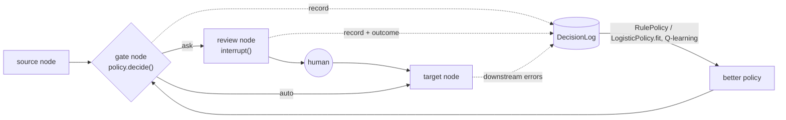

# hitl-gate

**Stop interrupting humans for things they always approve.** A learnable "should I ask a human?" gate for LangGraph human-in-the-loop steps.

 

[한국어 README](README.ko.md)


In the bundled simulated document pipeline ([`examples/document_pipeline`](examples/document_pipeline/run.py), 1,000 held-out runs, all numbers from a simulation):

- **AlwaysAsk** sends 3.00 items per run to a human and lets 0.9 errors per 100 runs through.
- A **RulePolicy** fitted from 500 logged runs asks 1.29 times per run (**57% fewer reviews**) at 2.2 errors per 100 runs, cutting total cost from 3.23 to 1.84 per run.
- A **LogisticPolicy** (per-item error probability, asks when it exceeds `review_cost / miss_cost` = 4%) fitted on the same logs asks 0.83 times per run (**72% fewer reviews**) at 3.0 errors per 100 runs, the lowest total cost: 1.84 → **1.58** per run.
- **NeverAsk** lets 13.9 errors per 100 runs through. Removing review entirely is not the answer.

## Why

Most agent graphs put `interrupt()` at every review point. That is safe on day one, and then:

- **Review fatigue.** Humans see hundreds of items that are fine, and start approving without looking (rubber-stamping). The review step keeps its cost and stops catching errors.
- **Removing the step is unsafe.** Some items really do need a human, and you can't tell which ones by intuition.
- **Decide per item, with evidence.** Most items fall into situations where humans have approved unchanged hundreds of times. Others don't. `hitl-gate` logs every review decision and its outcome, and uses that log to decide per item whether asking is worth it.

## 30-second quickstart

```bash
pip install git+https://github.com/doertail/hitl-gate   # not on PyPI yet
```

```python
from typing import Annotated, TypedDict
from langgraph.checkpoint.memory import MemorySaver
from langgraph.graph import END, START, StateGraph
from hitl_gate import AlwaysAsk, DecisionLog, RulePolicy, add_gated_review, merge_dicts

class State(TypedDict, total=False):
    run_id: str
    hitl_decisions: Annotated[dict, merge_dicts]  # where gate decisions live
    draft: str
    confidence: str

builder = StateGraph(State)
builder.add_node("draft", lambda s: {"draft": "Dear customer, ...", "confidence": "high"})
builder.add_node("send", lambda s: {})
builder.add_edge(START, "draft")

log = DecisionLog("decisions.jsonl")
gate = add_gated_review(
    builder, "review_draft", source="draft", target="send",
    policy=AlwaysAsk(),                                   # start safe
    featurize=lambda s: {"confidence": s["confidence"]},  # discrete, observable signals
    make_review_payload=lambda s: {"draft": s["draft"]},  # what the human sees
    apply_answer=lambda s, a: a.get("changes", {}),       # human edits -> state update
    log=log,
)
builder.add_edge("send", END)
graph = builder.compile(checkpointer=MemorySaver())       # interrupts need a checkpointer

# later, once the log has evidence:
gate.policy = RulePolicy.fit(log.records, keys=["confidence"])
```

Resume an interrupt the usual LangGraph way, with the answer format the gate expects:

```python
from langgraph.types import Command

graph.invoke(Command(resume={"outcome": "approve", "review_seconds": 12.0}), config)
# outcome: "approve" | "edit" | "retry" | "escalate";  optional "changes": {...}
```

`hitl_gate.sim.run_episode(graph, inputs, reviewer, thread_id)` does the invoke / interrupt / resume loop for you with a scripted reviewer, which is handy for tests and simulations.

## Tool-call approval

Most real HITL in agents is approving **tool calls** ("send_email", "issue_refund"). Wrap the risky tools with `gated_tool`: per call, the policy says ask (interrupt for approve / edit / reject / respond) or auto (the tool just runs). Untouched tools are never gated.

```python
from langgraph.prebuilt import ToolNode
from hitl_gate import AlwaysAsk, DecisionLog, RulePolicy, gated_tool

log = DecisionLog("tool_decisions.jsonl")
refund = gated_tool(
    issue_refund, policy=AlwaysAsk(), log=log,               # gate_id defaults to the tool name
    featurize=lambda name, args: {"big": args["amount"] > 50},
)
tools = ToolNode([lookup_order, refund])                     # or create_agent(model, tools=[lookup_order, refund], checkpointer=...)

# interrupt value (LangChain HITLRequest shape): {"action_requests": [{"name", "args", "description"}], "review_configs": [...], "hitl_gate": {...}}
graph.invoke(Command(resume={"decisions": [{"type": "approve"}]}), config)
#   {"type": "edit", "edited_action": {"name": "issue_refund", "args": {"amount": 20}}} | {"type": "reject", "message": "..."} | {"type": "respond", "message": "..."}

refund.gate.policy = RulePolicy.fit(log.records, keys=["big"])  # small refunds auto, big ones still asked
log.mark_downstream(tool_message.tool_call_id, "issue_refund", True)  # a refund that later went wrong
```

With LangChain's `create_agent`, you can instead swap the official middleware for a gated one. It keeps the official request/response format and batching, so existing approval UIs (e.g. Agent Inbox-style) keep working:

```python
from hitl_gate.middleware import GatedHumanInTheLoopMiddleware   # pip install "hitl-gate[langchain]"

agent = create_agent(model, tools, checkpointer=MemorySaver(), middleware=[
    GatedHumanInTheLoopMiddleware({"issue_refund": True, "send_email": True}, policy=policy, log=log, featurize=featurize),
])
```

| Integration | Needs | Tested with |
|---|---|---|
| `gated_tool(...)` in `ToolNode`, a hand-built ReAct graph, or `create_agent(tools=...)` | core only (`langgraph`, which brings `langchain-core`) | langgraph 1.2.14, langgraph-prebuilt 1.1.0, langchain-core 1.6.9 |
| `GatedHumanInTheLoopMiddleware` for `create_agent` | `hitl-gate[langchain]` (`langchain>=1.4`, which added `InterruptOnConfig.when`) | langchain 1.4.4 |

Sync and async (`ainvoke`) are both tested. `run_id` in the log is the **tool call id** (also `ToolMessage.tool_call_id`) and `gate_id` is the tool name, so `mark_downstream(tool_call_id, tool_name, error)` labels one call. `human_outcome` adds `"reject"` and `"respond"` for tool calls. Each decision may carry `"review_seconds"`.

**Determinism on resume.** There is no separate gate node here: on resume LangGraph re-runs the tool (or the middleware's `after_model`) from the top. The decision is cached in memory per `(thread_id, gate_id, tool_call_id)` until it is logged, and audit sampling is a stable hash of `(seed, gate_id, thread_id:tool_call_id)` (`GateDecider(..., key=...)`), not the next draw of a stream. A resumed call therefore reaches the same decision and logs exactly one record, even after a process restart if `seed` is set and the policy is deterministic. The tests check this.

[`examples/tool_approval`](examples/tool_approval/run.py) runs a support agent offline (scripted model, simulated reviewer, ~3 s): after 200 always-ask conversations a fitted `RulePolicy` auto-approves refunds ≤ 50 (131 of 137 in the next 200, 6 audited) while larger refunds and every email still go to a human.

## How it works



`add_gated_review` inserts two nodes between `source` and `target`:

- **`{gate_id}__gate`**: featurizes the state, asks the policy, applies shadow mode and audit sampling, and stores the decision in `state["hitl_decisions"][gate_id]`. It routes with a conditional edge.
- **`{gate_id}__review`**: calls `interrupt({"gate_id", "reason", "payload"})`, then applies the human answer and logs the outcome.

The decision lives in its own node on purpose. **When LangGraph resumes after `interrupt()`, the interrupting node runs again from the top.** If the ask/auto coin flip (audit sampling, exploration) happened inside that node, it would be re-rolled on resume. Here the decision is checkpointed before the interrupt and the review node only reads it. The test suite checks this.

If you wire graphs yourself, use `GateDecider(policy, mode, audit_rate, seed)` directly: it returns a plain dict you store in state, and `make_record(run_id, gate_id, decision, answer)` builds the log entry.

**Seeding.** Audit sampling draws from one RNG per gate, seeded from `f"{seed}:{gate_id}"` (hashed with SHA-512, stable across processes, unlike Python's salted `hash()`). Passing the same `seed` to every gate is fine: each gate gets an independent, reproducible stream, and one `GateDecider` serving several gates behaves like one decider per gate.

## Policies

| Policy | Asks when | Learns from |
|---|---|---|
| `AlwaysAsk` | always (today's default) | — |
| `NeverAsk` | never (baseline only) | — |
| `RulePolicy.fit(records, keys, min_count=30, max_change_rate=0.02)` | the bucket `(gate_id, feature values)` has fewer than `min_count` reviewed samples **or** a miss rate above `max_change_rate`. Unknown buckets → ask. `describe()` prints the rules. | logged reviews |
| `LogisticPolicy.fit(records, threshold, min_gate_samples=0)` | `p(miss) > threshold`. `p` is a logistic regression over all of the item's features (numbers standardised, everything else one-hot) plus a per-gate intercept; set `threshold = review_cost / miss_cost` (float, or dict per gate). One model can be **pooled across gates**, so a low-volume gate borrows what high-volume gates learned. Unseen gates, or gates under `min_gate_samples` → ask. `proba()`, `save()`/`load()` JSON. Pure Python, no extra dependency. | logged reviews (same miss label as `RulePolicy`) |
| `QTablePolicy` | `Q(ask) >= Q(auto)` for `(gate_id, discretized features)`. Ties and unseen states → ask. `act()` for epsilon-greedy training, `learn_episode()`, `save()`/`load()` JSON. | your reward signal (e.g. `-review_cost`, `-error_cost`) |

`RulePolicy` buckets only use the `keys` a gate's features actually contain, so one `keys` list can span gates with different features, and `describe()` shows each gate's own conditions.

**`QTablePolicy` learning rate.** `update()` and `learn_episode()` take `alpha` as a float (fixed rate), `"visit"` (`1/n` per `(state, action)`, i.e. Q is the running mean of its targets), or a callable `alpha(n)`. With rare, large costs (an error that slips through is much more expensive than a review) a fixed rate makes Q jump every time one of those costs lands; `"visit"` averages them out. For `1/n` with a floor, so the table keeps adapting later on, pass `alpha=lambda n: max(1 / n, 0.001)`. Visit counts live in `policy.n` and are saved by `save()`; files from 0.1.0 load with empty counts.

Any object with `name: str` and `decide(gate_id, features) -> (ask: bool, reason: str)` is a policy.

### Rubber-stamp protection

A review that says "approve" is not proof that the item was fine. `RulePolicy` counts a sample as a **miss** if the human changed the result **or** if it was approved and later failed downstream (`DecisionLog.mark_downstream(run_id, gate_id, error=True)`). A bucket where reviewers wave everything through, but errors keep appearing later, stays "ask" instead of being learned as safe.

## Safe rollout

1. **Shadow.** `add_gated_review(..., mode="shadow")`: the human is always asked; the log records what the policy *would* have done (`mode="shadow"`). Compare would-be autos against real outcomes before trusting it.
2. **Capped auto with audits.** Go live with `audit_rate=0.05`: 5% of auto decisions are still sent to a human and logged as `mode="audit"`. That gives you unbiased samples of what auto lets through.
3. **Roll back on downstream errors.** Mark downstream failures in the log and refit. Auto-passed items that failed downstream count as misses, so the affected bucket returns to "ask" on the next fit. Swap the policy in place with `gate.policy = RulePolicy.fit(...)`.

## Logging format

One `DecisionRecord` per gate decision (JSONL when `DecisionLog(path)` is given).

The file is **append-only**: `append` writes one record line and `mark_downstream` writes one small patch line, `{"_patch": {"run_id", "gate_id", "downstream_error"}}`, so marking stays O(1) however large the log is. `DecisionLog.from_jsonl(path)` replays the patches (and reads 0.1.0 files unchanged). Call `log.compact()` to rewrite the file once with patches merged. `DecisionLog(path)` appends to an existing file; it does not load or truncate it.

| field | meaning |
|---|---|
| `run_id`, `gate_id` | which run, which gate (`run_id` read from `state[run_id_key]`) |
| `features` | output of `featurize(state)` |
| `decision` | what the **policy** decided: `"ask"` / `"auto"` |
| `policy_name`, `reason` | which policy, and why |
| `mode` | `"live"`, `"shadow"` (always asked) or `"audit"` (auto, sampled for review) |
| `human_outcome` | `"approve"`, `"edit"`, `"retry"`, `"escalate"` (review gates), `"reject"`, `"respond"` (tool calls), or `None` if nobody was asked |
| `changed` | `human_outcome != "approve"` |
| `review_seconds` | from the answer |
| `downstream_error` | filled later via `mark_downstream` |
| `ts` | unix time, stamped by the log's `clock` on `append` |

For byte-reproducible logs, pass a fixed clock: `DecisionLog(path, clock=lambda: 0.0)`. Together with a fixed `seed`, two runs then write identical files.

Auto passes are logged by the gate node. Asked items are logged once the human answers, so a review that never comes back leaves no record.

## Limitations

- **Simulated results depend on their assumptions.** The plot comes from a toy pipeline with made-up error rates, catch rate (90%) and costs (1 review = 1, 1 missed error = 25). Your numbers will differ. Run shadow mode on your own traffic first.
- **Never gate legally or contractually required approvals.** If a human must sign off, keep `interrupt()` unconditional.
- **Features must be discrete for buckets and Q-tables** (`LogisticPolicy` takes numeric features as they are). Buckets and Q-tables need a handful of values per feature. Bucket continuous signals in `featurize` (or use `QTablePolicy(bins=...)`). Too many features means too few samples per bucket, so everything stays "ask", which is the safe failure mode.
- **Tabular RL is simple by design.** `QTablePolicy` is a transparent baseline, not a state-of-the-art learner. In the example it trains on a fast pure-Python mirror of the simulation (fixed `alpha=0.02`) and does not beat the rule policy.
- `retry` and `escalate` are logged, but routing stays `review -> target`. For retry loops, wire your own edges using `GateDecider`.
- **Tool calls: parallel gated calls need one task per call.** `create_agent` and `create_react_agent` already dispatch each call with `Send`. A plain `ToolNode` that receives several gated calls in one message runs them in threads inside one task, where interrupts are matched by order, which is racy. Use `Send`, or the middleware (one batched interrupt).
- **Tool calls: `gated_tool` cannot redirect an edit to another tool** (the middleware can). A gated tool must be invoked with a `ToolCall`, as `ToolNode` does, not with plain args.
- **Tool calls: the decision cache is in-process.** After a restart a pending call's decision is recomputed: stable for deterministic policies with a `seed`, not for random or swapped policies. A call interrupted and never resumed stays in the cache. A tool that itself calls `interrupt()` would be logged twice.
- **Logs are in-memory or a local JSONL file.** No database backend, no cross-process locking; several workers appending to one file is unsupported.

## Related work

- **Learning to Defer** (Madras, Pitassi & Zemel, NeurIPS 2018): train a model to decide when to hand a prediction to a human expert.
- **Ask4Help** (Singh et al., [arXiv 2211.09960](https://arxiv.org/abs/2211.09960)): learn a policy for when an embodied agent should request expert help.

## Development

```bash
python3 -m venv .venv            # tested with Python 3.14, langgraph 1.2.14, langchain 1.4.4
.venv/bin/pip install -e ".[dev,examples]"
.venv/bin/pytest -q
.venv/bin/python examples/document_pipeline/run.py   # ~25 s, writes docs/tradeoff.png
.venv/bin/python examples/tool_approval/run.py       # ~3 s, tool-call approval
```

The example is seeded and reproducible. See [CHANGELOG.md](CHANGELOG.md) for changes between versions.

## License

MIT. See [LICENSE](LICENSE).
